# 구현 다이어그램
> 구현마다 이 파일 하나를 최신화하여 갱신한다.
>
> 점선은 미구현 흐름을 나타낸다.

## 씬 흐름·스테이지 선택 (F-03, F-10, F-11, F-12, F-13)

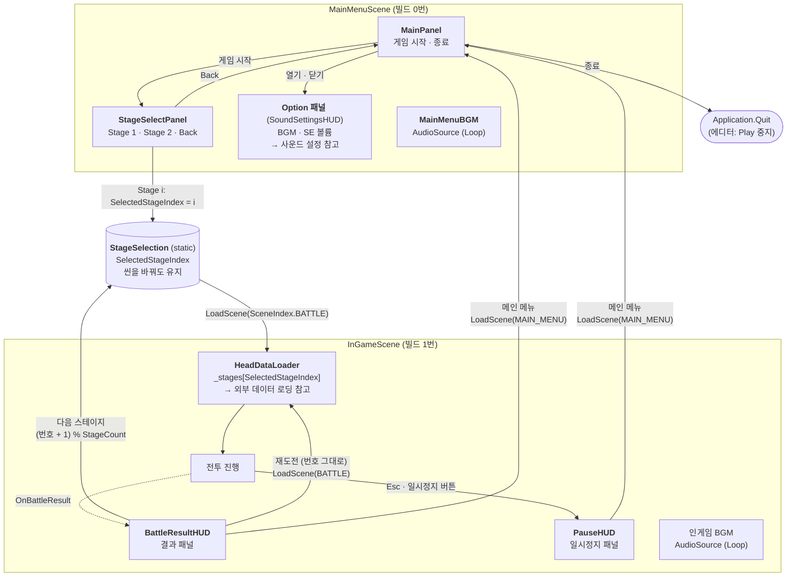

> 전투 씬에서 다른 씬으로 가는 모든 버튼은 로드 전에 `TimeManager.Resume()`으로 `timeScale`을 1로 되돌린다. `timeScale`은 static 값처럼 씬을 바꿔도 남는다.

> `SceneIndex`의 번호는 `File > Build Profiles > Scene List` 순서와 같아야 한다. 전투 씬을 바로 실행하면 `SelectedStageIndex` 기본값 0으로 스테이지 1이 로드된다.

## 외부 데이터 로딩 (F-01, F-03)

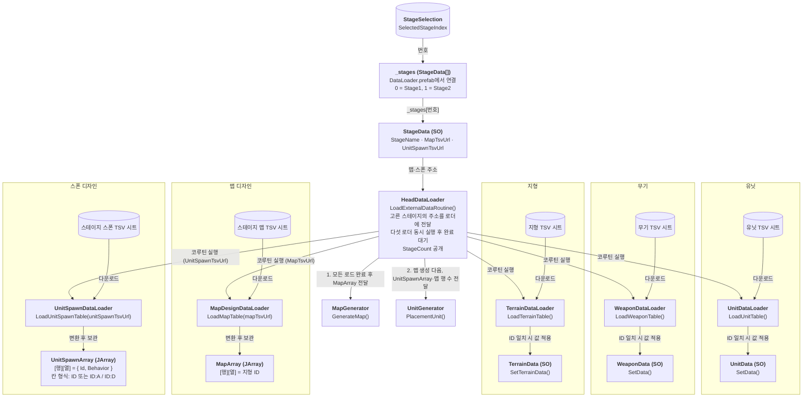

### 로더 내부 처리 순서 (유닛·무기 공통)

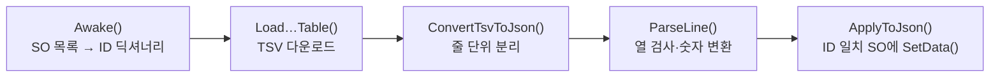

### 맵 로더 내부 처리 순서

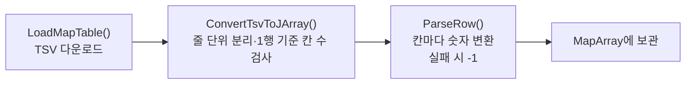

## 맵 생성 (F-03, F-05)

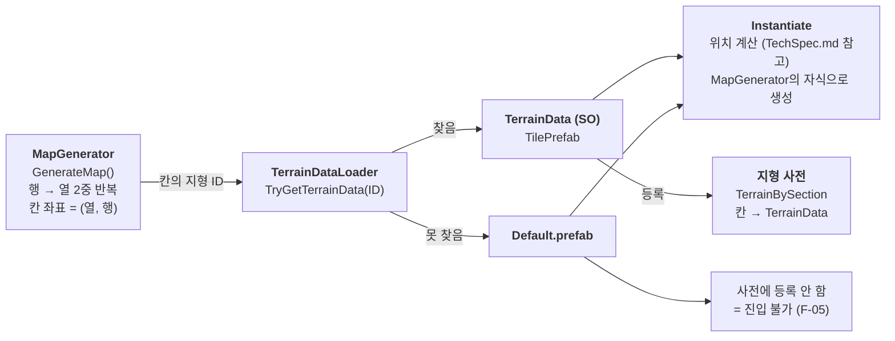

## 유닛 생성 (F-03, F-04, F-05)

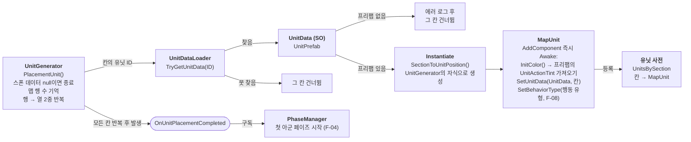

## 유닛·무기 연결 (F-01)

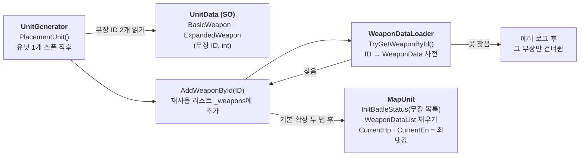

## 맵 입력·카메라 준비 (F-02, F-03)

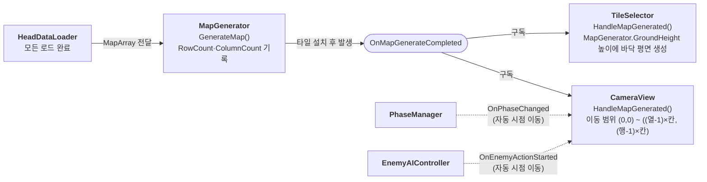

> 자동 시점 이동은 `카메라 이동` 다이어그램 참고. 아군 목록은 `UnitGenerator.GetUnitsByTeam()`으로 얻는다.

### 칸 강조 처리 순서 (TileSelector, 매 프레임)

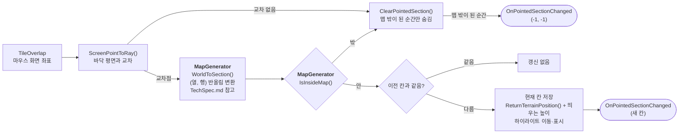

> 두 이벤트는 칸이 바뀔 때만 나간다. 호버 정보창·예상 전투 결과(F-10)가 구독한다.

### 클릭 처리 (TileSelector, F-04)

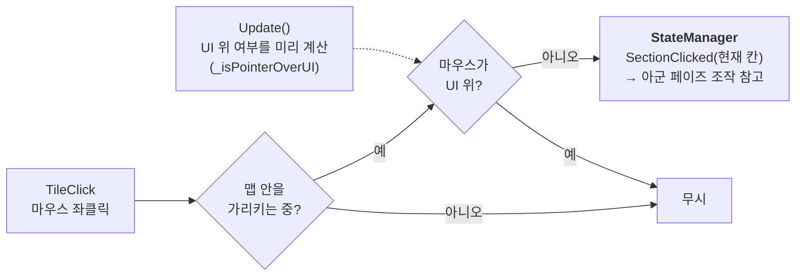

## 아군 페이즈 조작 (F-04)

### 구조: 페이즈(바깥) + 조작 단계(안쪽)

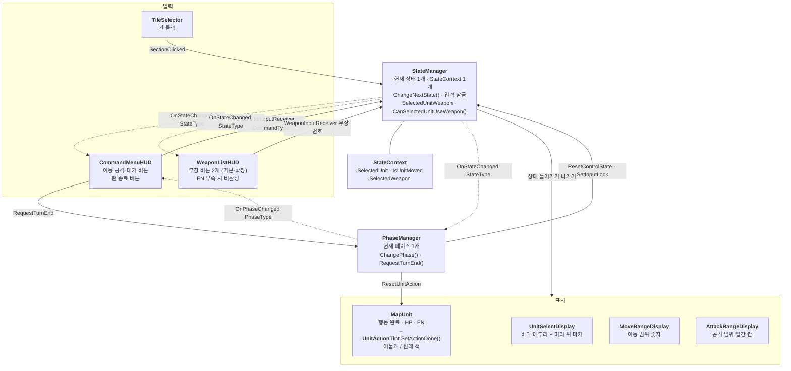

> 실선은 메서드 호출, 점선은 이벤트 구독이다. `TempLog`(디버그 전용)도 두 이벤트를 구독한다.

### 조작 단계 상태 전환 (StateManager)

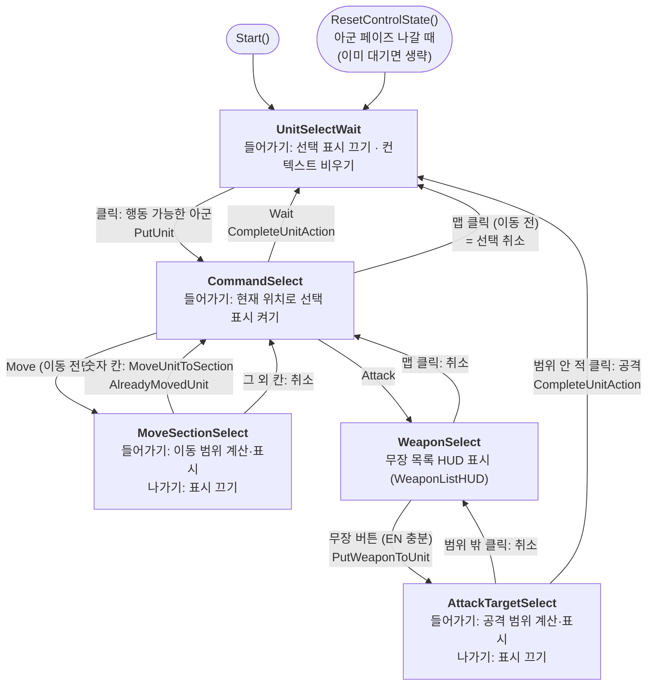

> 무장 버튼이 EN 부족이거나 범위 안 빈 칸·아군 칸을 클릭하면 `null`을 반환해 상태가 바뀌지 않는다.

> 이동 후 커맨드 선택에서는 맵 클릭을 무시하고, `Move`는 HUD(버튼 비활성)와 상태(`IsUnitMoved` 확인) 양쪽에서 막는다.

### 상태 전환 처리 순서 (ChangeNextState)


### 페이즈 전환 (PhaseManager)

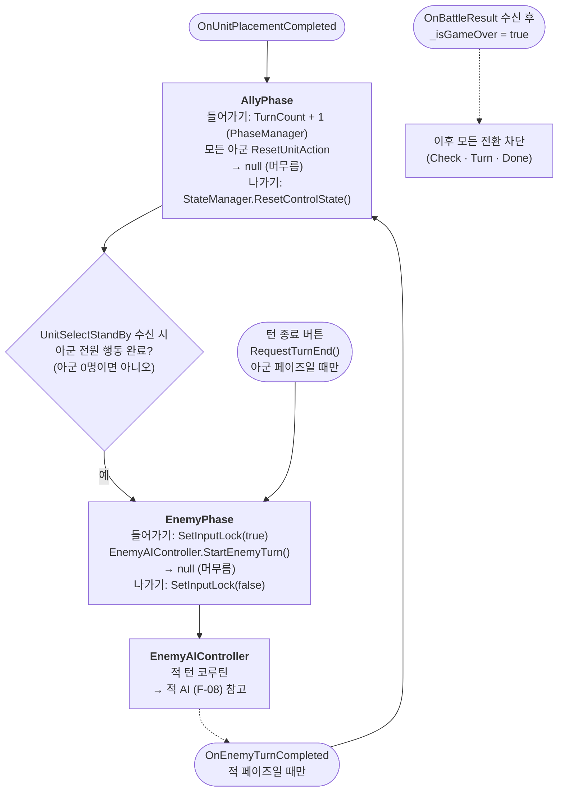

> 결과가 나면 `RequestTurnEnd`, `HandleEnemyTurnCompleted`, `HandleStateChanged`가 맨 앞 가드에서 돌아가 더 이상 전환하지 않는다. → 승패 판정 (F-09) 참고

### 페이즈 전환 처리 순서 (ChangePhase)

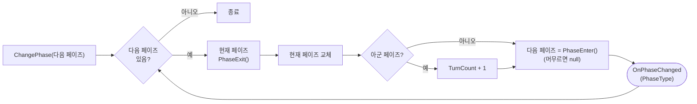

> 들어가기 안에서 직접 전환하지 않고 다음 페이즈를 반환하므로, 이벤트가 항상 `Enemy` → `Ally` 순서로 나간다.

> `TurnCount`는 이벤트보다 먼저 올라가므로, 이벤트를 받은 HUD가 새 턴 번호를 읽는다.

### 커맨드 메뉴 HUD (CommandMenuHUD)


### 무장 목록 HUD (WeaponListHUD)

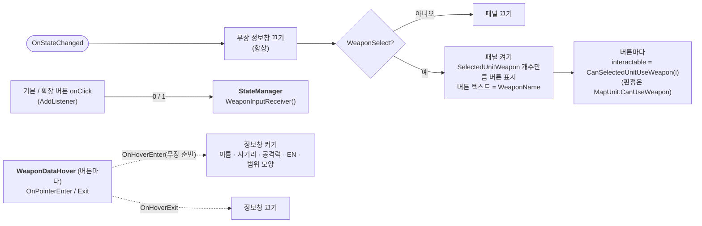

> 무장 정보창은 Raycast를 받지 않는다. 받으면 버튼을 덮어 진입·이탈이 반복되며 깜빡인다. 비활성 버튼도 호버는 받는다.

## 무장 공격 (F-06, F-07, F-24)

### 공격 범위 계산 (AttackRangeCalculator)

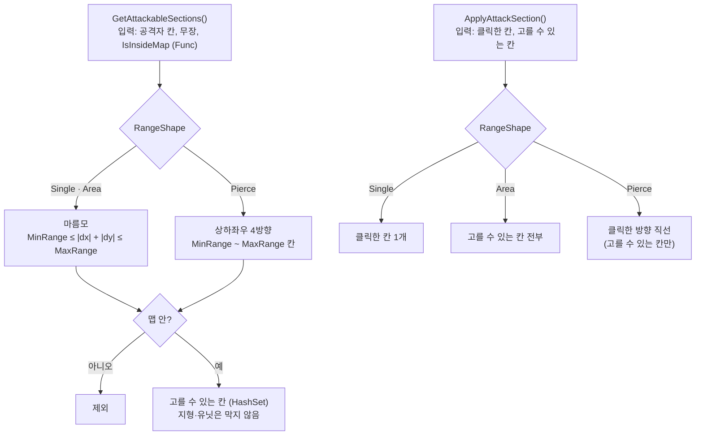

> 계산기는 칸 좌표만 다루고 유닛·상태·`MapGenerator`를 모른다. 적 AI(F-08)에서 재사용한다.

### 공격 실행 처리 순서 (AttackTargetSelect.SectionClick)

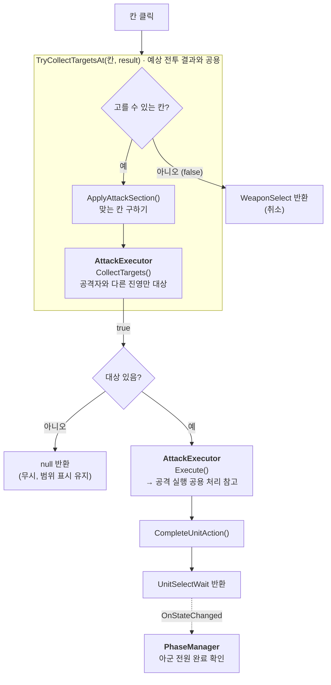

### 공격 실행 공용 처리 (AttackExecutor, F-07, F-09)

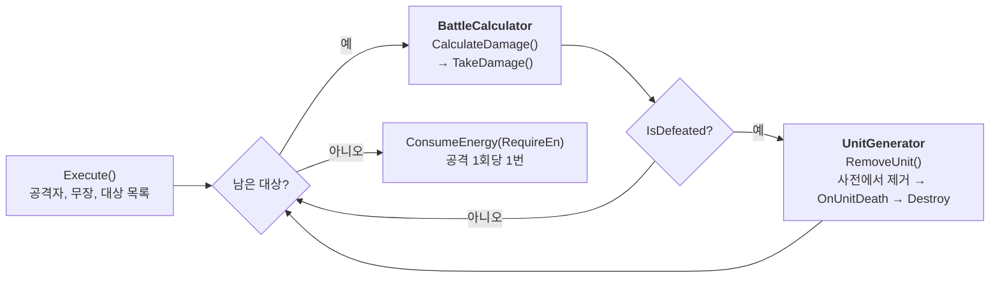

> 아군(`AttackTargetSelect`)과 적(`EnemyAIController`)이 같은 처리를 쓴다. `OnUnitDeath`는 승패 판정 (F-09)이 구독한다.

## 적 AI (F-08)

### 적 턴 처리 순서 (EnemyAIController 코루틴)

```mermaid
flowchart TB
    Start["StartEnemyTurn()<br/>(EnemyPhase 들어가기)"] --> Copy["GetUnitsByTeam(ENEMY)<br/>적 목록 복사"]
    Copy --> Sort["CompareByMovementDescending<br/>이동력 내림차순 정렬"]
    Sort --> Loop{"남은 적?"}
    Loop -->|예| Focus(["OnEnemyActionStarted(적)"])
    Focus -.->|구독| Cam["<b>CameraView</b><br/>그 적으로 시점 이동"]
    Focus --> Wait["대기 _actionDelay"]
    Wait --> Act["ActEnemy()"]
    Act --> Done["CompleteUnitAction()"]
    Done --> Loop
    Loop -->|아니오| Last["대기 _actionDelay<br/>(적 0기여도 대기)"]
    Last --> Reset["적 전원 ResetUnitAction()"]
    Reset --> Evt(["OnEnemyTurnCompleted"])
    Evt -.->|구독| PM["<b>PhaseManager</b><br/>아군 페이즈로 전환"]
```

> `StartCoroutine`은 첫 `yield`까지 바로 실행되므로, 완료 이벤트는 반드시 대기 뒤에 나간다.

### 행동 결정 (ActEnemy)

```mermaid
flowchart TB
    In["<b>MovementRangeCalculator</b><br/>이동 가능 칸 계산"] --> Find["TryFindBestAttack()<br/>서는 칸(제자리 + 이동 가능 칸)<br/>× EN 충분한 무장<br/>× 상대 진영 유닛 칸 클릭"]
    Find --> Score["조합마다 점수<br/>Σ min(데미지, 대상 HP)<br/>+ 격파 수 × _defeatScoreBonus"]
    Score --> Any{"0점보다 큰<br/>조합 있음?"}
    Any -->|예| Atk["AttackFrom()<br/>MoveUnitToSection() (칸이 다르면)<br/>→ AttackExecutor.Execute()"]
    Any -->|아니오| Type{"BehaviorType"}
    Type -->|Assault 돌격형| Near["MoveTowardNearestAlly()<br/>아군 칸 출발 다익스트라 (이동력 무제한)<br/>→ 값이 가장 작은 이동 가능 칸으로"]
    Type -->|Defend 거점형| Stay["제자리 대기"]
```

### 공격 범위 표시 (AttackRangeDisplay, 오브젝트 풀)

```mermaid
flowchart LR
    Recv["ShowAttackRangeHighlight()<br/>월드 위치 목록"] --> Off["ClearHighlights()<br/>전부 끄기"]
    Off --> Lack{"보유 개수가<br/>필요 개수보다 적음?"}
    Lack -->|예| Dup["DuplicateHighlight()<br/>AttackRangeQuad 복제 후 끄기"]
    Dup --> Lack
    Lack -->|아니오| On["<b>AttackRangeHighlight</b><br/>ShowAttackRange()<br/>위치 + _prefabHeight"]
```

## 승패 판정·결과 (F-09, F-11)

### 판정과 진행 중단

```mermaid
flowchart TB
    Exec["<b>AttackExecutor</b><br/>Execute() 격파<br/>(아군 공격 · 적 AI 공통)"] --> Rm["<b>UnitGenerator</b><br/>RemoveUnit()<br/>사전에서 제거 → 이벤트 → Destroy"]
    Rm -.->|"OnUnitDeath(MapUnit)"| Judge

    subgraph Judge["BattleResultJudge"]
        direction TB
        Ended{"_isGameOver?"}
        Ended -->|아니오| Cnt["진영별 집계<br/>ENEMY → EnemyKillCount + 1<br/>ALLY → AllyDeathCount + 1"]
        Cnt --> E0{"남은 적 0명?"}
        E0 -->|예| Win["EndBattle(Victory)"]
        E0 -->|아니오| A0{"남은 아군 0명?"}
        A0 -->|예| Lose["EndBattle(Defeat)"]
    end
    Ended -->|예| Ignore["무시"]
    A0 -->|아니오| Ignore

    Win --> Evt(["_isGameOver = true<br/>OnBattleResult(BattleResult)"])
    Lose --> Evt
    Evt -.->|구독| PM["<b>PhaseManager</b><br/>SetBattleResult()<br/>_isGameOver = true<br/>SetInputLock(true)<br/>EnemyAIController.StopEnemyTurn()"]
    Evt -.->|구독| HUD["<b>BattleResultHUD</b><br/>결과 패널 표시"]
```

> 범위 무장으로 여러 기를 한 번에 격파해도 이벤트는 기체마다 오고, 결과는 마지막 1기에서 한 번만 난다.

### 결과 패널 (BattleResultHUD)

```mermaid
flowchart LR
    R(["OnBattleResult"]) --> On["_resultPanel 켜기"]
    On --> Title["제목<br/>Victory → Stage Clear<br/>Defeat → Defeated"]
    On --> Stat["Turn = PhaseManager.TurnCount<br/>격파 = EnemyKillCount<br/>손실 = AllyDeathCount"]
    On --> Next["다음 스테이지 버튼<br/>승리 시에만 표시"]
    NextBtn["다음 스테이지 onClick"] --> Idx["SelectedStageIndex =<br/>(번호 + 1) % HeadDataLoader.StageCount<br/>마지막 다음은 스테이지 1"]
    Idx --> Load
    Retry["재도전 onClick<br/>(번호 그대로)"] --> Load["LoadSceneWithTimeReset()<br/>TimeManager.Resume()<br/>→ LoadScene(SceneIndex.BATTLE)"]
    Menu["메인 메뉴 onClick"] --> LoadM["LoadSceneWithTimeReset()<br/>TimeManager.Resume()<br/>→ LoadScene(SceneIndex.MAIN_MENU)"]
```

> HUD 스크립트는 항상 켜진 오브젝트에 두고 `_resultPanel`만 끄고 켠다. 꺼진 오브젝트에 두면 `OnEnable`이 불리지 않아 구독하지 못한다.

> `BattleResultHUD`는 `CommandUI.prefab` 안에 있어 `_headDataLoader`, `_timeManager`, `_battleResultJudge`는 씬 인스턴스에서 연결한다. 프리팹 파일끼리는 서로를 참조할 수 없다.

## 일시정지 (F-10)

```mermaid
flowchart TB
    Esc["Esc<br/>GameMap/Pause"] -->|TogglePause| TM
    PBtn["일시정지 버튼"] -->|Pause| TM
    RBtn["재개 버튼"] -->|Resume| TM
    MBtn["메인 메뉴 버튼"] -->|"Resume → LoadScene(MAIN_MENU)"| TM

    subgraph TM["TimeManager"]
        direction TB
        Over{"_isGameOver?<br/>(Pause만 확인)"}
        Set["SetPaused()<br/>IsPaused 갱신<br/>Time.timeScale = 0 / 1"]
        Over -->|아니오| Set
    end
    Over -->|예| Ignore["무시"]

    Judge["<b>BattleResultJudge</b>"] -.->|"OnBattleResult<br/>_isGameOver = true"| TM
    Set --> Evt(["OnPauseChanged(bool)"])
    Evt -.->|구독| HUD["<b>PauseHUD</b><br/>_pausePanel.SetActive(isPaused)"]
    Evt -.->|미구현| Sound["사운드<br/>일시정지 중 소리 멈춤"]
```

> `PauseHUD`는 입력 전달과 패널 표시만 하고 `timeScale`을 직접 다루지 않는다. 시간은 `TimeManager`만 다룬다.

> `timeScale = 0`이 멈추는 것: 적 행동 대기(`WaitForSeconds`), 카메라 이동(`deltaTime`). 멈추지 않는 것: `Update()`, 입력. 그래서 패널 배경 Image가 Raycast를 받아 칸 클릭(`TileSelector._isPointerOverUI`)과 뒤쪽 버튼을 막는다.

## 사운드 설정 (F-13)

```mermaid
flowchart LR
    subgraph HUD["SoundSettingsHUD (MainMenuScene)"]
        direction TB
        Load["Start: LoadVolumes()<br/>패널 끄기<br/>PlayerPrefs.GetFloat(키, 1)<br/>Slider.SetValueWithoutNotify()"]
        Change["Slider onValueChanged<br/>ChangeVolume()<br/>PlayerPrefs.SetFloat()"]
        Close["닫기 버튼<br/>PlayerPrefs.Save()<br/>패널 끄기"]
        Apply["ApplyVolume()<br/>Max(값, 0.0001)<br/>Log10(값) × 20 = dB"]
        Load --> Apply
        Change --> Apply
    end

    Apply -->|"SetFloat(BGMVolume · SFXVolume)"| Mixer["<b>MainMixer</b><br/>Exposed Parameter<br/>BGM 그룹 · SFX 그룹"]
    MBgm["MainMenuBGM<br/>AudioSource"] -->|출력| Mixer
    IBgm["인게임 BGM<br/>AudioSource"] -->|출력| Mixer
    Pause(["TimeManager.OnPauseChanged"]) -.->|미구현| Mixer
```

> `PlayerPrefs` 키는 Exposed Parameter 이름과 같다. `AudioMixer.SetFloat`은 `Awake`에서 적용되지 않아 `Start`에서 불러온다.

> SFX 그룹으로 출력하는 AudioSource는 아직 없다. 볼륨 불러오기는 메인 메뉴에만 있어, 인게임 씬을 바로 실행했을 때 저장값 적용 여부는 미검증이다.

## 인게임 UI (F-10, F-07)

### 구독 구조

```mermaid
flowchart LR
    PM["<b>PhaseManager</b>"] -.->|"OnPhaseChanged"| TP["<b>TurnPhaseHUD</b><br/>턴 텍스트: Turn N<br/>페이즈 텍스트: Ally/Enemy Phase"]
    PM -.->|"OnPhaseChanged"| HI
    TS["<b>TileSelector</b>"] -.->|"OnPointedSectionChanged"| HI["<b>HoverInfoHUD</b><br/>지형 · 유닛 · HP · EN"]
    TS -.->|"OnPointedSectionChanged"| BF["<b>BattleForecastHUD</b><br/>예상 전투 결과"]
    SM["<b>StateManager</b>"] -.->|"OnStateChanged"| HI
    SM -.->|"OnStateChanged"| BF
    BF -->|"TryGetForecastTargets()<br/>SelectedUnit · SelectedWeapon"| SM
    TS -.->|"OnPointedSectionChanged"| US["<b>UnitStatusHUD</b><br/>HP · EN · MV<br/>이동 · 공격 READY / DONE"]
    SM -.->|"OnStateChanged"| US
    PM -.->|"OnPhaseChanged"| US
    US -->|"SelectedUnit · IsSelectedUnitMoved"| SM
    US -->|"TryGetUnitAtSection()"| UG
    HI -->|"TerrainBySection"| MG["<b>MapGenerator</b>"]
    HI -->|"TryGetUnitAtSection()"| UG["<b>UnitGenerator</b>"]
```

> 칸 변경 외에 상태·페이즈 변경 때도 마지막 칸으로 다시 그려, 같은 칸에 마우스를 둔 채 공격·이동이 끝나도 최신 값을 보인다.

### 호버 정보창 (HoverInfoHUD.Refresh)

```mermaid
flowchart LR
    In["마지막 칸"] --> Out{"(-1, -1) 또는<br/>지형 사전에 없음?"}
    Out -->|예| Off["패널 끄기"]
    Out -->|아니오| Ter["지형 텍스트<br/>이름 = TileName<br/>이동 비용 = RequireMove<br/>(진입 불가면 Impassable)"]
    Ter --> U{"TryGetUnitAtSection?"}
    U -->|예| Unit["SetUnitInfoActive(true)<br/>이름 · 진영 · HP 현재/최대 · EN 현재/최대"]
    U -->|아니오| Hide["SetUnitInfoActive(false)<br/>유닛 텍스트 4개 끄기"]
    Unit --> Show["패널 켜기"]
    Hide --> Show
```

> 유닛 텍스트는 그룹 오브젝트 없이 개별로 끈다. 꺼진 자식은 Layout Group 배치에서 빠져 패널이 줄어든다.

### 예상 전투 결과 (BattleForecastHUD.Refresh)

```mermaid
flowchart LR
    In["마지막 칸"] --> Ask["<b>StateManager</b><br/>TryGetForecastTargets()"]
    Ask --> St{"AttackTargetSelect<br/>상태?"}
    St -->|아니오| Off["패널 끄기"]
    St -->|예| Col["<b>AttackTargetSelect</b><br/>TryCollectTargetsAt()<br/>(실제 공격과 같은 코드)"]
    Col --> Any{"범위 안 · 대상 있음?"}
    Any -->|아니오| Off
    Any -->|예| Label["RefreshLabel()<br/>라벨 = 공격자 → 피격자1, 피격자2"]
    Label --> Line["RefreshDesc()<br/>대상마다 <b>BattleCalculator</b>.CalculateDamage()<br/>HP 현재 → 이후 (-데미지)<br/>대상 2명 이상이면 줄 앞에 이름<br/>이후 0이면 DEFEAT"]
    Line --> On["패널 켜기"]
```

> 맵 위 정보창들은 Raycast를 받지 않는다. 받으면 `TileSelector`가 UI 위로 판단해 칸 클릭이 무시된다.

### 유닛 상태창 (UnitStatusHUD.Refresh)

```mermaid
flowchart LR
    In["이벤트 수신<br/>(칸 변경이면 마지막 칸 저장)"] --> Sel{"<b>StateManager</b><br/>SelectedUnit 있음?"}
    Sel -->|예| Unit["표시 유닛 = 선택 유닛"]
    Sel -->|아니오| Pt{"마지막 칸이 (-1, -1)이 아니고<br/>TryGetUnitAtSection?"}
    Pt -->|예| Unit2["표시 유닛 = 가리킨 유닛"]
    Pt -->|아니오| Off["패널 끄기"]
    Unit --> Gauge
    Unit2 --> Gauge["ShowGauge()<br/>HP · EN fillAmount = 현재 / 최대<br/>텍스트 현재 / 최대, MV = 이동력"]
    Gauge --> Act["ShowAction()<br/>공격 DONE = IsUnitActionDone<br/>이동 DONE = IsUnitActionDone<br/>또는 (선택 유닛 && IsSelectedUnitMoved)"]
    Act --> On["패널 켜기"]
```

> 이동 여부는 `StateContext`에만 있어 선택 중인 유닛만 알 수 있다. 행동을 마친 유닛은 이동도 할 수 없으므로 함께 DONE으로 표시한다.

## 이동 범위 (F-05)

### 이동 범위 계산 (MovementRangeCalculator, 다익스트라)

```mermaid
flowchart TB
    In["입력: 출발 칸, 이동력, 진영<br/>지형 사전, 유닛 사전"] --> Init["결과 사전[출발 칸] = 0<br/>후보 목록에 출발 칸"]
    Init --> Loop{"후보 목록<br/>남음?"}
    Loop -->|예| Pick["누적 비용이 가장 싼 칸 꺼내기"]
    Pick --> Dir["4방향 이웃 칸마다 검사"]
    Dir --> A{"지형 사전에 없음<br/>또는 진입 불가 지형?"}
    A -->|예| Skip["건너뜀"]
    A -->|아니오| B{"다른 진영<br/>유닛 칸?"}
    B -->|예| Skip
    B -->|아니오| C{"현재 비용 + 들어갈 칸 RequireMove가<br/>이동력 초과?"}
    C -->|예| Skip
    C -->|아니오| D{"이미 같거나<br/>더 싼 비용 기록?"}
    D -->|예| Skip
    D -->|아니오| Rec["비용 기록<br/>후보에 없으면 추가"]
    Rec --> Loop
    Skip --> Loop
    Loop -->|아니오| Fin["출발 칸, 같은 진영 유닛 칸 제거<br/>(지나갈 수는 있지만 멈출 수 없음)"]
    Fin --> Out["결과: 칸 → 누적 비용"]
```

### 숫자 하이라이트 표시 (MoveRangeDisplay, 오브젝트 풀)

```mermaid
flowchart LR
    Recv["ShowMoveRangeHighlight()<br/>(월드 위치, 비용) 목록"] --> Off["ClearHighlights()<br/>전부 끄기"]
    Off --> Lack{"보유 개수가<br/>필요 개수보다 적음?"}
    Lack -->|예| Dup["DuplicateHighlight()<br/>MoveRangeIndicator 복제 후 끄기"]
    Dup --> Lack
    Lack -->|아니오| On["<b>MoveRangeHighlight</b><br/>ShowMoveRange()<br/>위치 + 높이, 숫자 = 비용"]
```

### 유닛 이동 (UnitGenerator)

```mermaid
flowchart LR
    Call["MoveUnitToSection()<br/>(MapUnit, 새 칸)"] --> Rm["유닛 사전에서<br/>옛 칸 Remove"]
    Rm --> Add["새 칸에 Add"]
    Add --> Set["MapUnit.SetUnitData()<br/>기존 UnitData + 새 칸"]
    Set --> Pos["transform.position<br/>= SectionToUnitPosition()"]
    Pos -.->|미구현, P2| Walk["한 칸씩 이동 연출"]
```

### 카메라 이동 (CameraView, 매 프레임)

```mermaid
flowchart LR
    Gen{"맵 생성 완료?"} -->|아니오| Stop["무시"]
    Gen -->|예| Input{"CameraMove<br/>WASD 입력 있음?"}
    Input -->|예| Cancel["_isFocusing = false<br/>(자동 이동 취소)"]
    Cancel --> Dir["Pivot right·forward로<br/>월드 방향 변환<br/>속도 × deltaTime 만큼 이동"]
    Dir --> Clamp["ClampToMap()<br/>X·Z를 이동 범위로 제한"]
    Input -->|아니오| Foc{"_isFocusing?"}
    Foc -->|아니오| Stop
    Foc -->|예| Smooth["MoveToFocus()<br/>SmoothDamp(목표, _focusSmoothTime)"]
    Smooth --> Arrive{"거리²가 FOCUS_ARRIVE_SQR_DISTANCE 미만?"}
    Arrive -->|예| Snap["목표 위치로 맞추고<br/>_isFocusing = false"]
    Clamp --> Pivot["<b>InGameCameraPivot</b><br/>위치 적용<br/>(자식 카메라 60° 기울기)"]
    Smooth --> Pivot
    Edge["화면 가장자리 이동<br/>(미구현, P2)"] -.-> Dir
```

### 자동 시점 이동 목표 설정 (CameraView.FocusOn)

```mermaid
flowchart LR
    PM(["PhaseManager.OnPhaseChanged"]) --> Ally{"Ally 페이즈?"}
    Ally -->|아니오| End["무시"]
    Ally -->|예| Fast["TryGetFastestAlly()<br/>GetUnitsByTeam(ALLY)<br/>이동력 최대 (같으면 먼저 찾은 유닛)"]
    AI(["EnemyAIController.OnEnemyActionStarted(적)"]) --> Focus
    Fast -->|찾음| Focus["FocusOn(유닛 위치)<br/>높이 유지, X·Z만 교체<br/>ClampToMap() → _focusTarget<br/>_focusVelocity = 0, _isFocusing = true"]
    Fast -->|없음| End
```

> 아군 페이즈는 시작 때만 비추고, 이후 시점은 플레이어가 조작한다. `deltaTime` 기반이라 일시정지 중에는 자동 이동도 멈춘다.
