# 구현 다이어그램
> 구현마다 이 파일 하나를 최신화하여 갱신한다.
>
> 점선은 미구현 흐름을 나타낸다.

## 외부 데이터 로딩 (F-01, F-03)

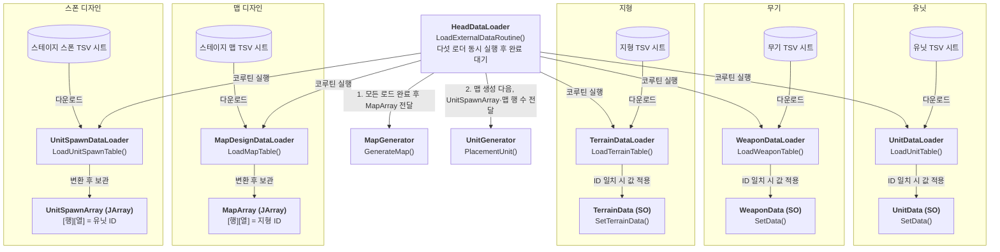

### 로더 내부 처리 순서 (유닛·무기 공통)

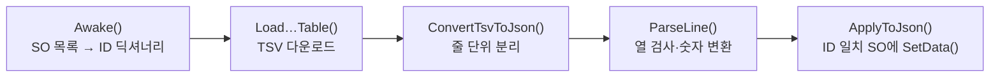

### 맵 로더 내부 처리 순서

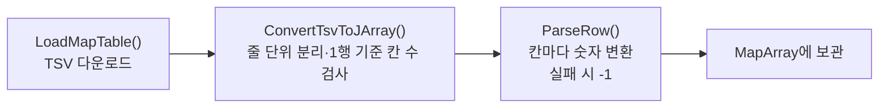

## 맵 생성 (F-03, F-05)

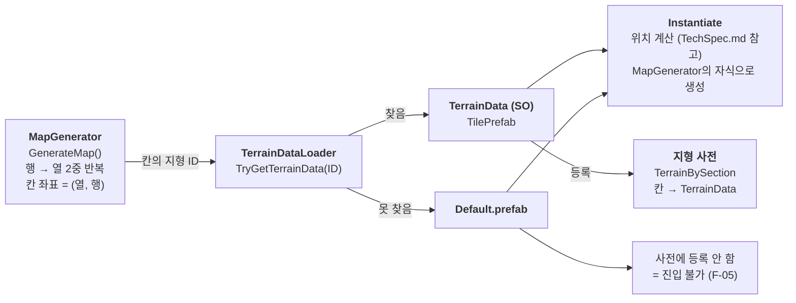

## 유닛 생성 (F-03, F-05)

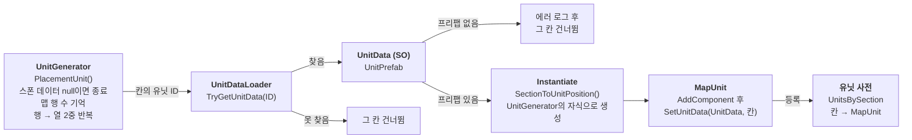

## 유닛·무기 연결 (미구현, P1 11/14)

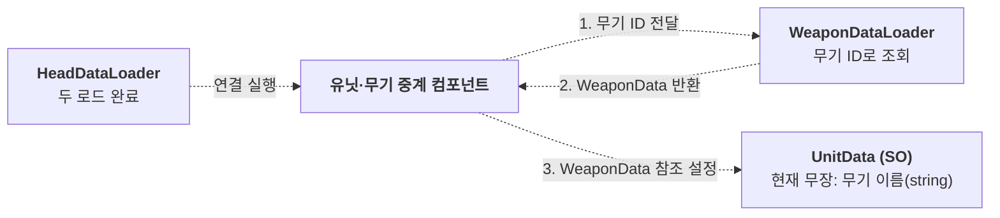

## 맵 입력·카메라 준비 (F-02, F-03)

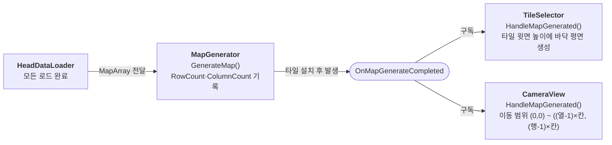

### 칸 강조 처리 순서 (TileSelector, 매 프레임)

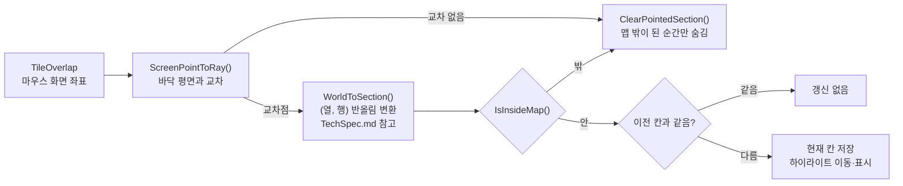

### 클릭 처리 (TileSelector, F-05)

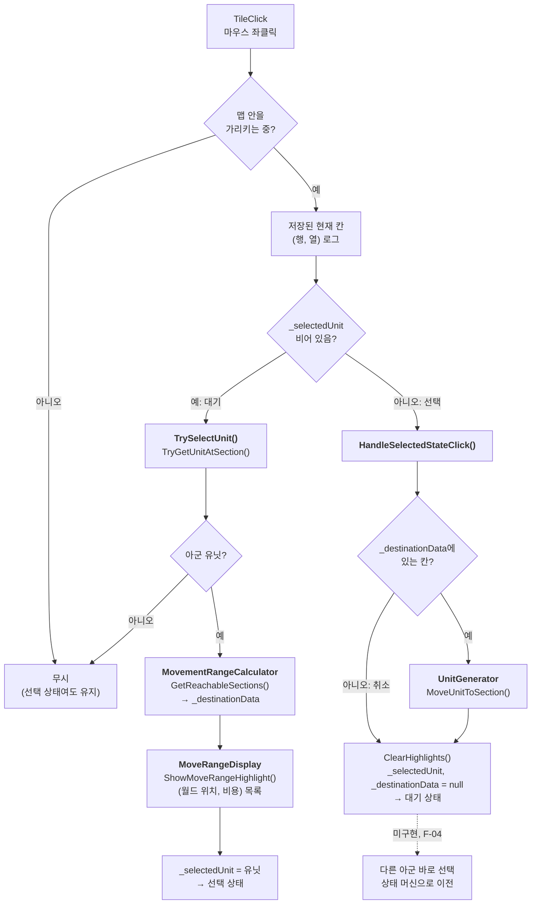

## 이동 범위 (F-05)

### 이동 범위 계산 (MovementRangeCalculator, 다익스트라)

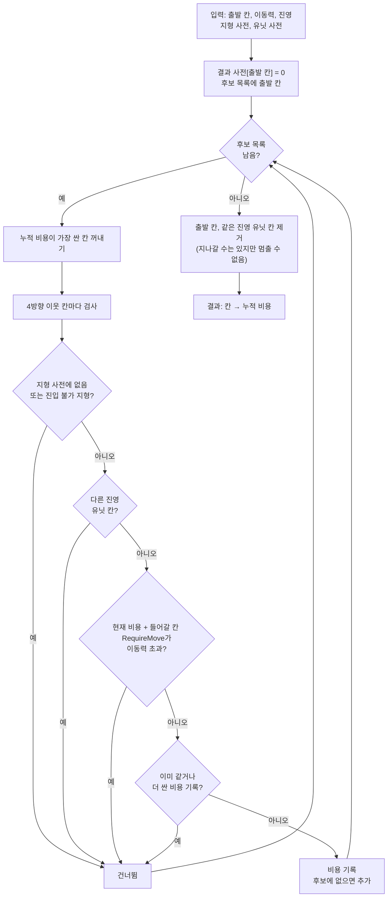

### 숫자 하이라이트 표시 (MoveRangeDisplay, 오브젝트 풀)

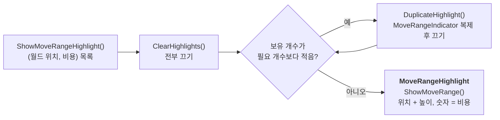

### 유닛 이동 (UnitGenerator)

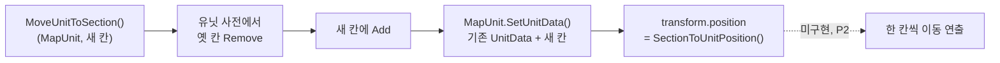

### 카메라 이동 (CameraView, 매 프레임)

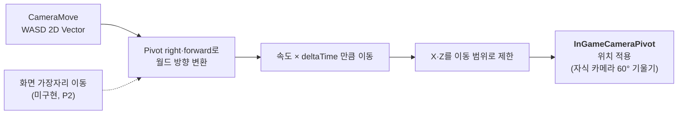
