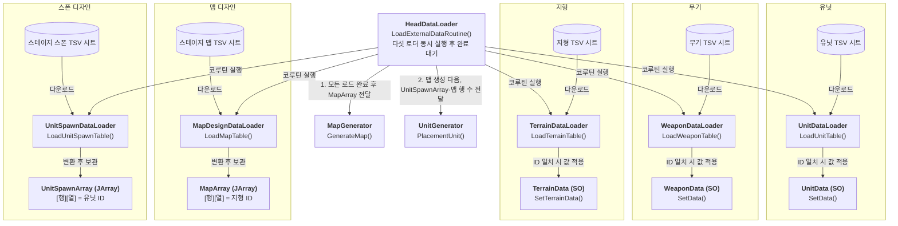
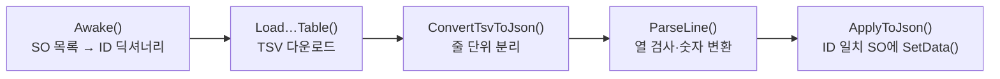
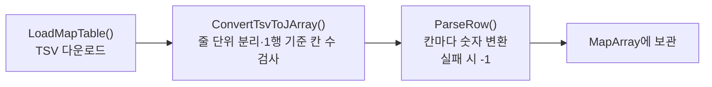
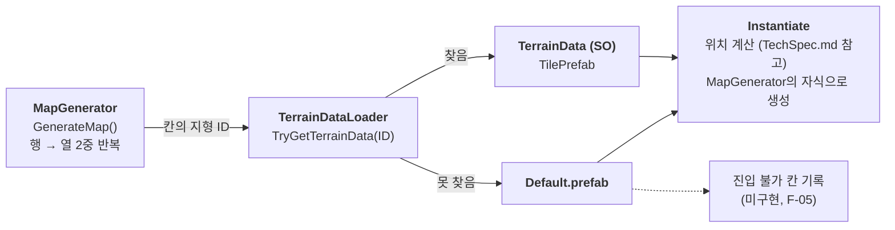
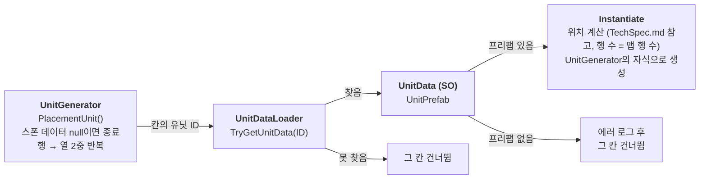
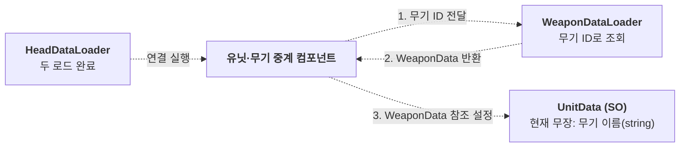

# 구현 다이어그램
> 구현마다 이 파일 하나를 최신화하여 갱신한다.
>
> 점선은 미구현 흐름을 나타낸다.

## 외부 데이터 로딩 (F-01, F-03)

### 로더 내부 처리 순서 (유닛·무기 공통)

### 맵 로더 내부 처리 순서

## 맵 생성 (F-03)

## 유닛 생성 (F-03)

## 유닛·무기 연결 (미구현, P1 11/14)

