# 구현 다이어그램
> 구현마다 이 파일 하나를 최신화하여 갱신한다.
>
> 점선은 미구현 흐름을 나타낸다.

## 외부 데이터 로딩 (F-01, F-03)

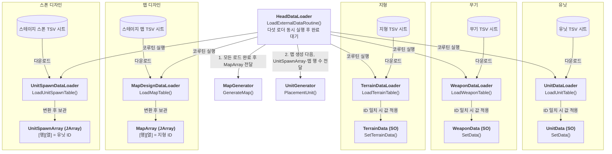

### 로더 내부 처리 순서 (유닛·무기 공통)

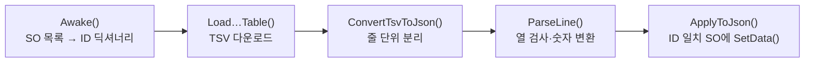

### 맵 로더 내부 처리 순서

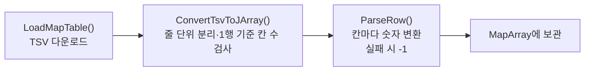

## 맵 생성 (F-03, F-05)

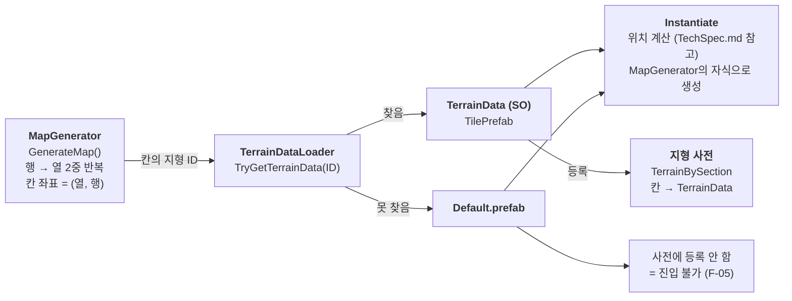

## 유닛 생성 (F-03, F-04, F-05)

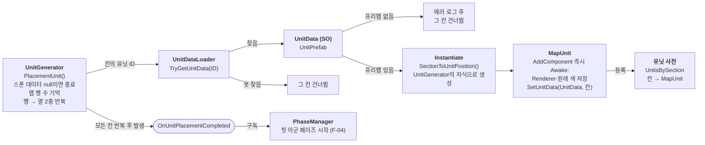

## 유닛·무기 연결 (미구현, P1 11/14)

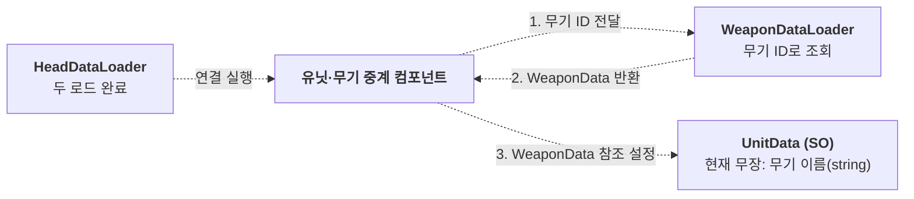

## 맵 입력·카메라 준비 (F-02, F-03)

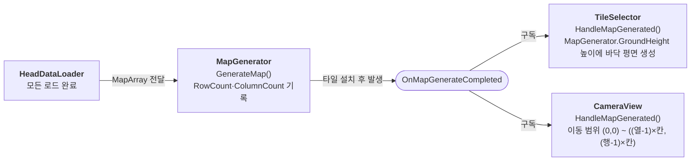

### 칸 강조 처리 순서 (TileSelector, 매 프레임)

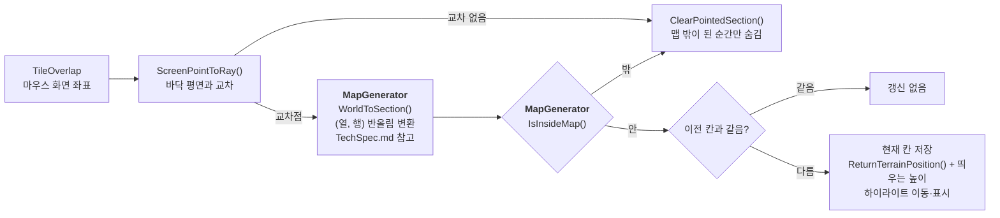

### 클릭 처리 (TileSelector, F-04)

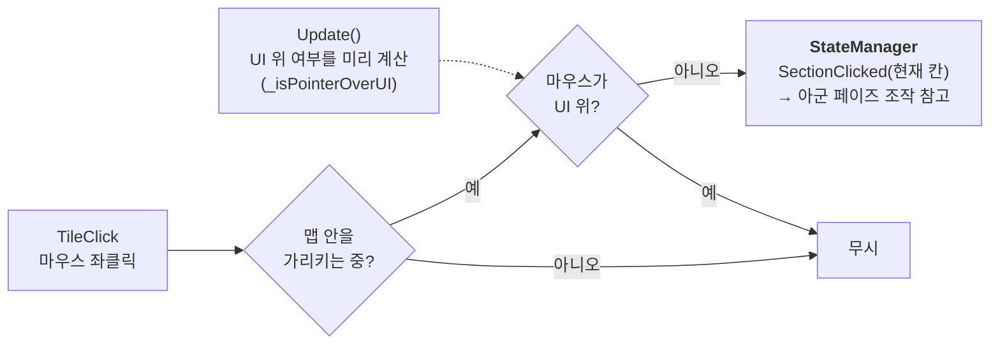

## 아군 페이즈 조작 (F-04)

### 구조: 페이즈(바깥) + 조작 단계(안쪽)

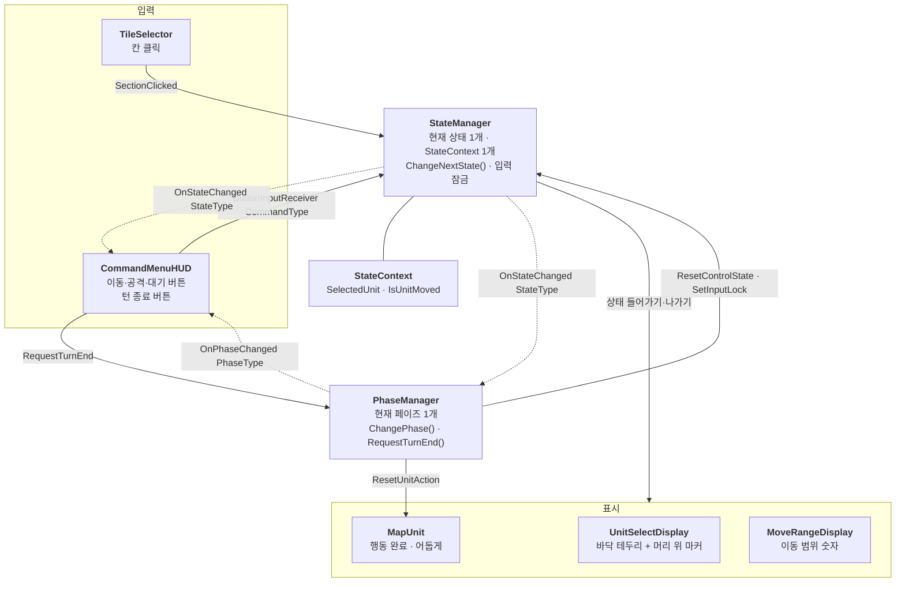

> 실선은 메서드 호출, 점선은 이벤트 구독이다. `TempLog`(디버그 전용)도 두 이벤트를 구독한다.

### 조작 단계 상태 전환 (StateManager)

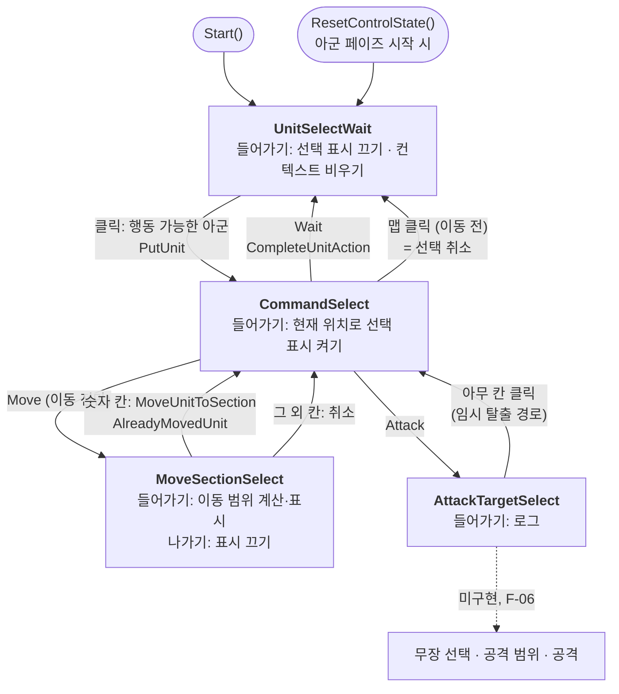

> 이동 후 커맨드 선택에서는 맵 클릭을 무시하고, `Move`는 HUD(버튼 비활성)와 상태(`IsUnitMoved` 확인) 양쪽에서 막는다.

### 상태 전환 처리 순서 (ChangeNextState)

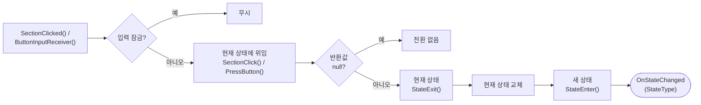

### 페이즈 전환 (PhaseManager)

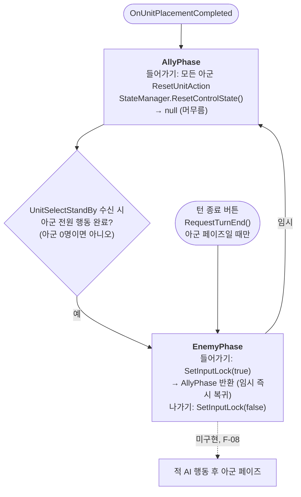

### 페이즈 전환 처리 순서 (ChangePhase)

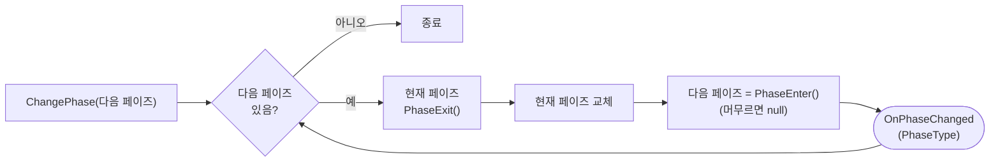

> 들어가기 안에서 직접 전환하지 않고 다음 페이즈를 반환하므로, 이벤트가 항상 `Enemy` → `Ally` 순서로 나간다.

### 커맨드 메뉴 HUD (CommandMenuHUD)

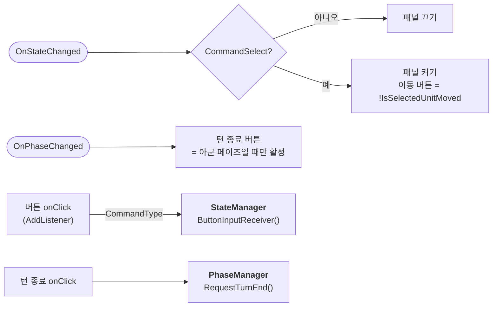

## 이동 범위 (F-05)

### 이동 범위 계산 (MovementRangeCalculator, 다익스트라)

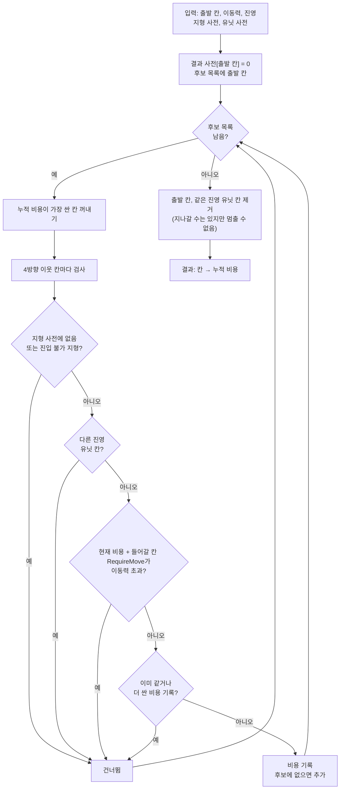

### 숫자 하이라이트 표시 (MoveRangeDisplay, 오브젝트 풀)

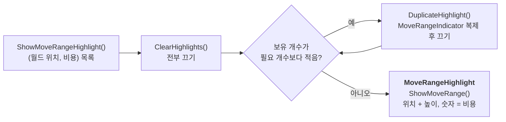

### 유닛 이동 (UnitGenerator)

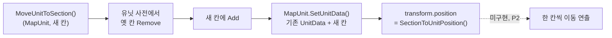

### 카메라 이동 (CameraView, 매 프레임)

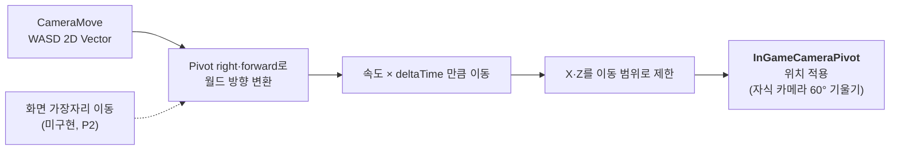
